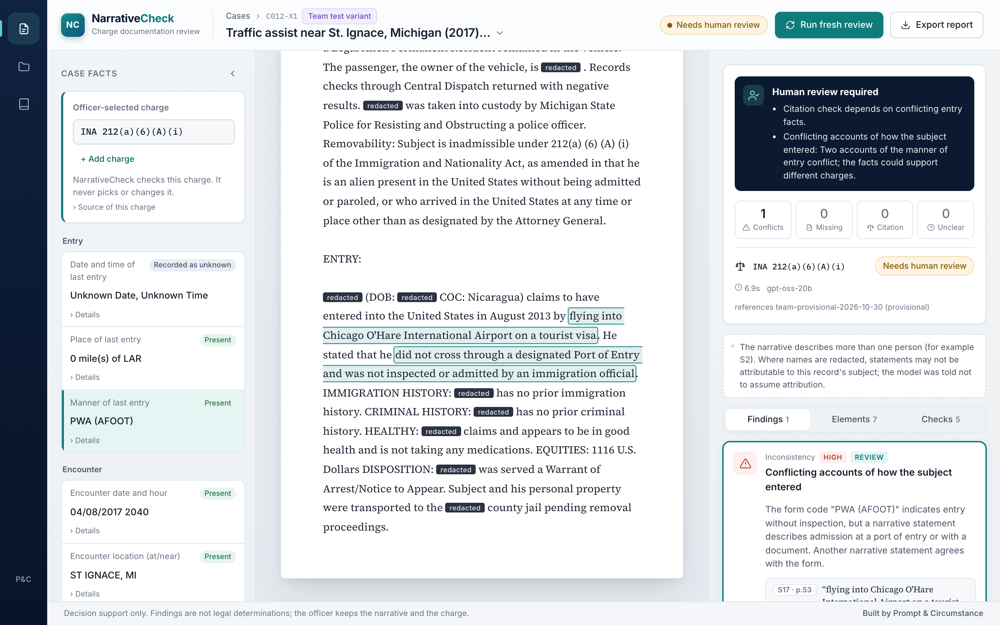

# NarrativeCheck

**Team: Prompt & Circumstance** · CHALLENGE X · Unissant use case: *GenAI-Assisted Gap Analysis for Investigative Charge Documentation*

NarrativeCheck reviews an officer-written charge narrative, the case facts behind it, and the officer-selected Title 8 / INA charge. It points out missing required information, internal inconsistencies, unclear statements, and possible citation mismatches. Every flag links to the exact sentence or form field it came from.

It **never** rewrites the narrative, never picks or changes the charge, and never fills in missing facts. Ambiguous and multi-charge cases go to a person.



*Live review of team test case C012-X1. Two conflicting statements about the manner of entry are highlighted and linked to the form field. The case is routed to human review.*

## What it does

| Area | Behavior |
|---|---|
| Document canvas | Original narrative with clickable highlights, source PDF page markers, redactions shown as labelled chips |
| Findings panel | Human-review indicator, citation check, required-elements checklist, findings with verified evidence |
| Case facts panel | Collapsible form fields with availability status (present, redacted, absent, unreadable), and the officer-selected charge |
| Corrections | The officer edits their own text or facts. Earlier findings are marked outdated until a fresh review runs |
| Report | One-page printable gap report per case (Export report, then Save as PDF) |

### Review pipeline

1. **Rule checks** (deterministic code):
   - required elements already recorded in form fields;
   - redacted fields treated as unavailable rather than missing;
   - "Unknown" values qualified as *recorded as unknown*;
   - multiple selected charges;
   - encounter time on the form vs. the arrest time in the narrative.
2. **Three parallel model requests** to the Unissant-hosted `gpt-oss-20b`:
   - two independent review samples (elements, issues, citation opinion);
   - one **fact extraction** (entry and removal statements with exact quotes).

   Case text is passed as data, never as instructions.
3. **Code compares the extracted facts** with the form fields and with each other: entry year, manner of entry, and prior removals. It also checks the selected charge's core requirement (for example, an overstay charge needs a documented admission).
4. **Verification:**
   - every quote must match the reviewed text exactly (redaction markers normalized), or the statement is withheld;
   - contradictions need two verified sources;
   - text that names or suggests another charge is removed from everything displayed;
   - a charge that fits only one of two conflicting accounts is marked *needs human review*.
5. **Honest status.** Each check reports *completed with findings*, *completed with no findings*, *partial*, or *unavailable*. If the model fails, the app says "Partial review" and substitutes nothing.

See [docs/ARCHITECTURE.md](docs/ARCHITECTURE.md) for request counts, timeouts and the measured latency.

## Evaluation (internal, team-created test cases)

We built 37 test cases: 9 verified adapted public records and 28 copies, each with one documented planted issue. Answers are kept separately from the inputs, and the cases are split into dev and held-out sets by base case. Full detail is in [eval/README.md](eval/README.md) and [eval/RUNS.md](eval/RUNS.md).

| Measure | Internal held-out run (untouched, 21 cases) | Deck target |
|---|---|---|
| Strict detection of planted issues | 83% (15/18) | at least 90%: **not met** |
| Incorrect flags (hand-adjudicated) | 28% (5/18) | at most 10%: **not met** |
| Ambiguous / multi-charge cases routed to a person, for the planted reason | 100% (2/2 and 3/3) | 100%: met |
| Evidence references reproduce the source text | 100% | every flag: met |
| Review time, p50 / max | 22s / 55s | under 60s: met |

Later runs after error analysis are **post-hoc** and do not replace this result. They are listed in `eval/RUNS.md`.

## Important limitations

- **References are provisional.** Unissant's charge reference sheet and required-elements list have not been received yet. [`config/references.json`](config/references.json) contains:
  - required elements taken from the instruction printed on Form I-213;
  - plain-English paraphrases of public statutory text, compiled by the team.

  Neither is sponsor-verified or legal advice.
- **Cases are adapted public records.** They come from a redacted public CBP release; see [Data and provenance](#data-and-provenance). The original records are not an answer key.
- **Evaluation scores are internal.** Planted-error test cases are team-created until Unissant supplies its test set. The single untouched held-out run does not meet the detection and incorrect-flag targets.
- **The shared endpoint can be slow.** Some reviews hit the 55-second limit and are reported as partial reviews.
- **Redacted names** often make it impossible to tell which person a statement belongs to. The app notes this and does not assume.
- The tool is decision support. Its output is not a legal determination.

## Run it

See [docs/SETUP.md](docs/SETUP.md). In short:

```bash
npm install
# create .env.local with CHALLENGEX_API_KEY (see docs/SETUP.md; never commit it)
npm run check:api
npm run dev
```

## Documentation

- [docs/HOW-IT-WAS-BUILT.md](docs/HOW-IT-WAS-BUILT.md): beginner-friendly walkthrough of every part
- [docs/ARCHITECTURE.md](docs/ARCHITECTURE.md): request flow and design decisions
- [DESIGN.md](DESIGN.md): visual and interaction rules
- [eval/README.md](eval/README.md): test set, splits, and matching policy
- [docs/DEMO-SCRIPT.md](docs/DEMO-SCRIPT.md): demo shot list and narration
- [docs/DEVLOG.md](docs/DEVLOG.md): development log

## Useful commands

| Command | What it does |
|---|---|
| `npm run check:api` | Tests the model connection (the key is never printed) |
| `npm run dev` | Starts the app at http://localhost:3000 (`/?set=eval` opens the evaluation cases) |
| `npm test` | Unit tests, no key needed |
| `npm run eval:build` | Rebuilds the test variants from `eval/variants.json` |
| `npm run eval -- --split dev` | Runs live reviews for a split and saves the results |
| `npm run eval:score -- eval/runs/<timestamp>` | Scores a run and writes `REPORT.md` |
| `node scripts/export-reports.mjs eval/runs/<timestamp>` | Writes a one-page PDF report per case from saved results |
| `npm run demo:record` | Records a captioned walkthrough video with Chrome (needs `npx playwright-core install ffmpeg` once) |

## Data and provenance

- Source: CBP, *Detroit Sector Forms I-213 and I-44 FY 2012 – 2019 Part 5* (public, redacted), [cbp.gov link](https://www.cbp.gov/sites/default/files/assets/documents/2022-Jan/Detroit%20Sector%20Forms%20I-213%20and%20I-44%20FY%202012%20%E2%80%93%202019%20Part%205_0.pdf). The PDF itself is not committed.
- `tools/extract/` holds the preparation scripts: embedded text plus local Apple Vision OCR, case grouping, and the case builder.
- `data/manifests/` holds hand-verified transcriptions with page numbers. `data/cases/` holds the generated case files the app loads.
- Each case records its source pages, extraction method, verification notes, and any synthetic replacements.

## Repository layout

```
app/                 Next.js app (page + /api/review server route)
components/          Review workspace UI
lib/review/          Rules, prompt, schema, pipeline
lib/llm.ts           Server-only model client (key never reaches the browser)
config/              Versioned reference rules (provisional)
data/                Case manifests and case files
tools/extract/       PDF extraction and case preparation (Python)
tests/               Unit tests
docs/                Setup, architecture, design, development log
```

## Model

Unissant-hosted `gpt-oss-20b` through its OpenAI-compatible endpoint. An OpenAI account is not used. The key is read from `CHALLENGEX_API_KEY` on the server only.

---
Built by **Prompt & Circumstance** for CHALLENGE X.
